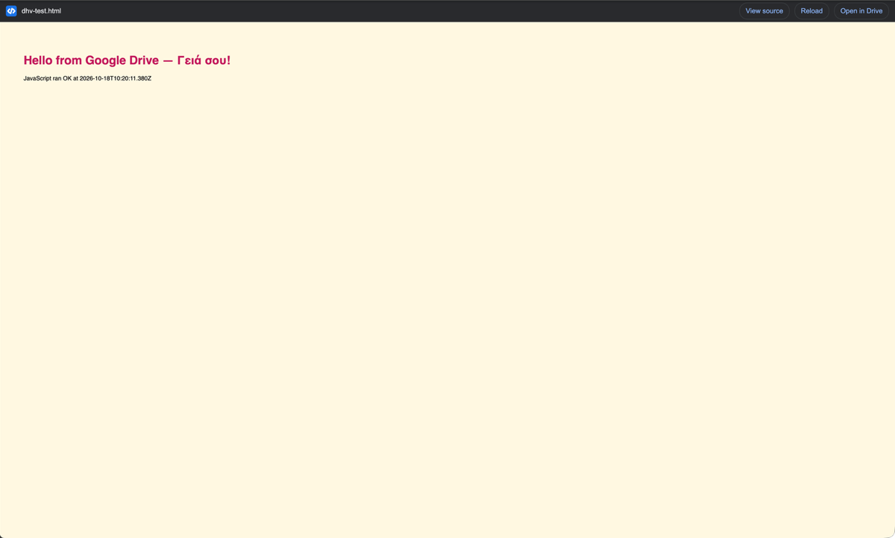
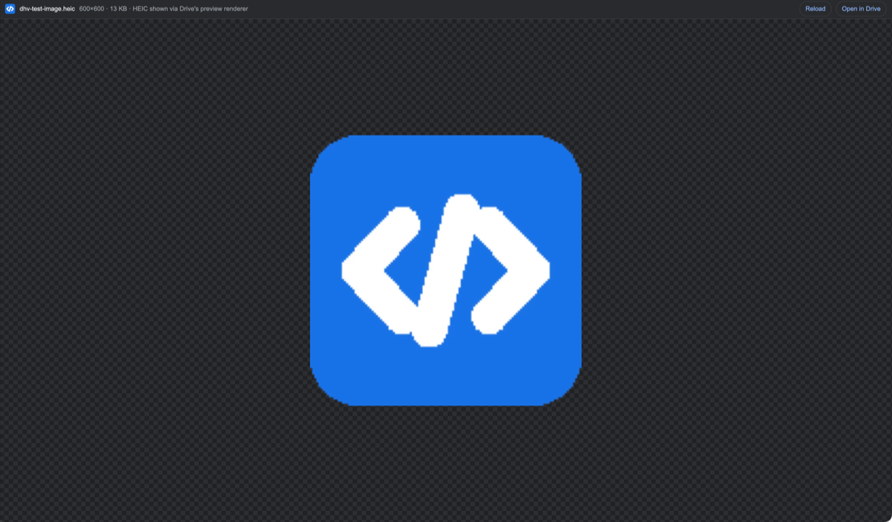
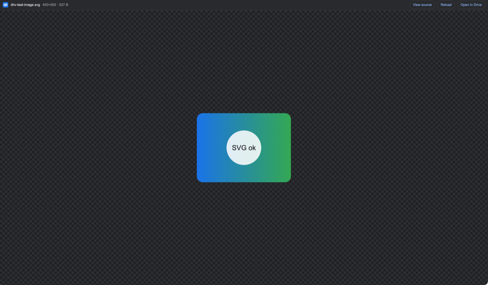

# Drive HTML & Image Viewer

A Chrome extension (Manifest V3) that opens **HTML files** and **images** stored in Google Drive directly in the
browser, without downloading them.

Without it, Drive shows an `.html` file as plain source text and asks you to download images it cannot preview
(HEIC, TIFF, PSD, RAW, SVGZ…). With it, a double-click or Enter opens the file rendered in a new tab.

| HTML rendered, scripts included | HEIC shown through Drive's converter | SVG on a transparency checkerboard |
|---|---|---|
|  |  |  |

## Features

- **HTML files** render as real web pages: CSS, inline and CDN scripts, fonts and non-Latin text all work.
- **Images Chrome can decode** are shown exactly as stored: JPEG, PNG, APNG, GIF, WebP, AVIF, BMP, ICO, SVG and
  gzipped SVGZ.
- **Other image formats** are shown through Google Drive's own preview converter: HEIC/HEIF, TIFF, PSD, JPEG XL,
  JPEG 2000, TGA, EPS/AI and camera RAW (DNG, CR2, CR3, NEF, ARW, RAF, ORF, RW2…).
- **Viewer bar** with the file name, pixel and file size, **View source** (HTML and SVG), **Reload** and
  **Open in Drive**. Click an image to switch between fit-to-window and actual size.
- **No setup:** it uses your existing Google sign-in in Chrome. There is no OAuth app, API key or Google Cloud
  project, and nothing is written to disk.
- **Several Google accounts:** the extension follows the account in the Drive URL (`/u/1/`, `?authuser=1`).

## Install

### From the Chrome Web Store

[Drive HTML & Image Viewer on the Chrome Web Store](https://chromewebstore.google.com/detail/akelnfjdgccopikemffiakdanjamnljp)
(submitted for review on 18 October 2026; the link works once Google approves it). Click **Add to Chrome**. Updates
install automatically.

### From a release

1. Download `drive-html-image-viewer-<version>.zip` from the
   [Releases page](https://github.com/BikS2013-tools/drive-html-image-viewer/releases) and unzip it.
2. Open `chrome://extensions` and turn on **Developer mode** (top right).
3. Click **Load unpacked** and select the unzipped folder (the one containing `manifest.json`).
4. Optional: pin the icon from the puzzle-piece menu.
5. **Reload any Google Drive tabs that were already open.** Chrome adds the extension only to pages loaded after
   installation.

### From source

```sh
git clone https://github.com/BikS2013-tools/drive-html-image-viewer.git
```

Then load the `extension/` folder with **Load unpacked** as above. After pulling changes, click the reload icon
on the extension's card in `chrome://extensions` and reload your Drive tabs.

Works in Chrome and other Chromium browsers that support Manifest V3 extensions (Edge, Brave, Arc…). Browsers
managed by an organization may block developer-mode extensions by policy.

## Usage

On `drive.google.com`:

| Action | What happens |
|---|---|
| **Double-click** an `.html` file or image | Opens it in the viewer in a new tab. Drive's own preview (or the Drive app set as default for that file type) still opens behind it. |
| **Select it and press Enter** (one click, or the arrow keys) | Opens it in the viewer. Drive's own preview does not open. |
| **Alt+double-click** / **Alt+Enter** | Opens only Drive's own preview, as if the extension were not installed. |
| Blue **Render HTML** / **View image** button (bottom right) | Appears when an HTML file or image is open in Drive's preview or selected in the list. |
| Extension toolbar icon, or **Alt+Shift+H** | Opens the file that is open or selected in Drive. |

Anywhere else (Gmail, Google Docs, Chat…), right-click a Drive file link and choose
**Open this Drive link in Drive Viewer**.

Clicking the toolbar icon on a page that isn't Drive opens a box where you can paste a Drive link or file ID.

Enter typed in Drive's search box, rename dialogs or other text fields is left alone. If several files are selected,
Enter is also left to Drive. To change the **Alt+Shift+H** shortcut, open `chrome://extensions/shortcuts`.

## How it works

1. **Which file:** the extension takes the file ID from the Drive URL, the focused or selected row in the Drive
   list, or the link you right-clicked.
2. **Downloading:** the viewer page (`viewer.html`, part of the extension) downloads the file into memory from
   `drive.usercontent.google.com/download?id=…`, with your existing Google session. A real file is recognised by
   its `Content-Disposition` header. A redirect to the sign-in page or an error page is reported as a clear message.
3. **Detecting the type:** from the file's first bytes, then its extension, then the `Content-Type` header.
4. **Rendering:**
   - **HTML** is handed to `sandbox.html`, a
     [sandboxed extension page](https://developer.chrome.com/docs/extensions/reference/manifest/sandbox) with an
     opaque origin. Scripts in the file run, but they cannot read your Google cookies, call extension APIs or reach
     the viewer page.
   - **Images Chrome can decode** are shown from an in-memory `blob:` URL through ``. SVGs are also shown
     through ``, so scripts embedded in an SVG never run.
   - **Other formats** are loaded from Drive's preview renderer (`drive.google.com/thumbnail?id=…&sz=w4000-h4000`),
     which converts them to a browser-friendly image.

## Permissions

| Permission | Why it is needed |
|---|---|
| `https://drive.google.com/*` | Runs the content script on Drive (double-click, Enter, button). Also covers the fallback download URL and Drive's preview renderer. |
| `https://drive.usercontent.google.com/*` | Downloads the file's contents. |
| `https://lh3.google.com/*`, `https://*.googleusercontent.com/*` | Drive's preview renderer serves converted images (HEIC, TIFF…) from these hosts. |
| `contextMenus` | Adds the right-click entry for Drive links. |
| `activeTab` | Reads the current tab's URL when you click the toolbar icon, press the shortcut or use the right-click entry. |

## Privacy and security

- **No data collection:** the extension sends nothing anywhere except to Google, to fetch the file you asked for.
  It has no analytics, tracking or remote code, and no storage of its own.
- **Access:** it can open only files that your signed-in Google account can already open.
- **Isolation:** HTML files run in a sandboxed, opaque-origin page, so a malicious HTML file in Drive cannot use
  your Google session or the extension's permissions. It can still do what any web page can, such as load content
  from the internet. Open HTML files only from sources you trust, as you would any web page.
- **SVG:** files are displayed as images, so their scripts never run.

Full privacy policy: [PRIVACY.md](PRIVACY.md).

## Limitations

- Only the one file is loaded. Relative references to other files in Drive (`style.css`, `img/logo.png`) do not
  resolve. Inline assets and absolute `https://` URLs (CDNs, etc.) work.
- Google Docs, Sheets and Slides are not HTML or image files and are rejected with a message.
- Images shown through Drive's converter are capped at 4000 px on the longest side and lose transparency
  (transparent areas in a TIFF turn black). Formats Drive itself cannot preview show an error.
- Double-click cannot stop Drive from also opening its own preview; use Enter if you want only the viewer.

## Troubleshooting

| Symptom | Fix |
|---|---|
| Double-click or Enter still shows only Drive's preview | Reload the Drive tab. Tabs opened before the extension was installed or updated don't have it yet. |
| "Drive asked for sign-in" | Sign in to Google in this Chrome profile with an account that can open the file, then click **Reload**. |
| "Drive returned 403/404" | The file doesn't exist, or the current Google account can't open it. With several accounts, open Drive under the account that owns the file (`/u/N/`). |
| Page renders, but images or styles are missing | The HTML references other files in Drive by relative path (see **Limitations**). |

## Project structure

```
extension/
├── manifest.json          Manifest V3: permissions, content script, shortcut, sandbox page and its CSP
├── background.js          Service worker: toolbar icon, shortcut, context menus, opens the viewer tab
├── content.js / .css      Runs on drive.google.com: double-click and Enter handling, floating button
├── viewer.html / .js / .css  Viewer page: downloads the file, detects its type, shows images, hosts the sandbox
├── sandbox.html / .js     Sandboxed page that renders HTML with document.write
└── icons/                 16, 48 and 128 px icons
docs/screenshots/          Images used in this README
store/                     Chrome Web Store assets: screenshots, promo tile and listing text (listing.md)
PRIVACY.md                 Privacy policy (linked from the store listing)
```

The extension has no dependencies and no build step: the files in `extension/` are loaded as they are.

## Releasing

1. Bump `version` in `extension/manifest.json`.
2. Build the zip:

   ```sh
   mkdir -p dist && (cd extension && zip -r ../dist/drive-html-image-viewer-$(jq -r .version manifest.json).zip . -x '.*')
   ```

3. Create a GitHub release with the zip attached:

   ```sh
   v=$(jq -r .version extension/manifest.json)
   gh release create "v$v" "dist/drive-html-image-viewer-$v.zip" --title "v$v" --notes "…"
   ```

## Sharing with a team

| Option | Effort | Recipient experience | Best for |
|---|---|---|---|
| **A. Release zip** | none | Unzip, then **Load unpacked** (see **Install**). Chrome shows a "developer mode extensions" notice. No auto-updates. | a few colleagues, quick |
| **B. Chrome Web Store, *Unlisted*** | one-time $5 developer registration, upload the zip, review takes ~1–3 days | One click **Add to Chrome** from a private link, with automatic updates | sharing broadly |
| **C. Chrome Web Store, *Private* (Google Workspace domain)** | same as B, visibility set to your Workspace domain | Only people in your domain can see and install it | an organization on Google Workspace |
| **D. Admin force-install** | Workspace admin adds the store item ID under Admin console → Devices → Chrome → Apps & extensions | Installed automatically on managed browsers | rolling out to a whole team |

Publishing to the Chrome Web Store (B/C):

1. Register at <https://chrome.google.com/webstore/devconsole> (one-time $5 fee).
2. **New item** → upload the release zip.
3. Fill in the listing: description, at least one 1280×800 screenshot, and `extension/icons/icon128.png`.
4. In **Privacy**, declare:
   - single purpose: "view HTML files and images stored in Google Drive";
   - host permissions: as in the **Permissions** table above;
   - no data collected or transmitted.
5. Set **Visibility** to *Unlisted* (B) or *Private* (C), then submit for review.

## License

[MIT](LICENSE) © 2026 Giorgos Marinos
